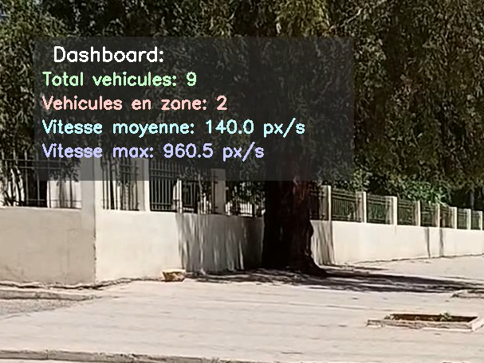

# Détection et suivi de véhicules (YOLOv8 + ByteTrack)

Ce projet analyse une vidéo de circulation routière : il détecte les véhicules,
les suit d'une image à l'autre, estime leur vitesse apparente et compte ceux qui
se trouvent dans une zone d'intérêt définie par l'utilisateur.

Il a été testé sur une vidéo filmée sur le boulevard Mohammed VI, à Khouribga.

## Fonctionnalités

- Détection des voitures, motos, bus et camions avec YOLOv8s pré-entraîné
- Suivi multi-objets avec ByteTrack (un identifiant stable par véhicule)
- Estimation de la vitesse apparente, en pixels par seconde
- Zones d'intérêt sous forme de polygones, définies dans un fichier JSON
- Tableau de bord superposé à la vidéo : total de véhicules, véhicules en zone,
  vitesse moyenne et maximale
- Export d'une vidéo annotée

## Installation

    git clone https://github.com/otman-aml/autonomous-vehicle-analytics.git
    cd autonomous-vehicle-analytics
    pip install -r requirements.txt

Les poids du modèle sont téléchargés automatiquement au premier lancement.

## Utilisation

    python vehicle_analytics.py --source data/demo_short.mp4

La vidéo annotée est enregistrée dans `outputs/annotated.mp4`.

Pour définir une autre zone d'intérêt, dessiner les points sur une image de la
vidéo (nécessite une interface graphique) :

    python tools/draw_polygons.py --video data/demo_short.mp4

Principales options :

| Option | Défaut | Description |
|---|---|---|
| `--source` | | Vidéo à analyser |
| `--output` | `outputs/annotated.mp4` | Vidéo annotée en sortie |
| `--model` | `yolov8s.pt` | Modèle YOLO utilisé |
| `--polygons` | `data/polygons.json` | Fichier des zones d'intérêt |
| `--conf` | `0.35` | Seuil de confiance de détection |
| `--min-hits` | `5` | Images de suivi minimales avant de compter un véhicule |
| `--max-speed` | `1000` | Vitesse (px/s) au-delà de laquelle la mesure est rejetée |

Le notebook `Prj_DL.ipynb` est la première version du projet, conçue pour
Google Colab.

## Fonctionnement

1. YOLOv8 détecte les véhicules sur chaque image.
2. ByteTrack leur associe un identifiant qui persiste d'une image à l'autre.
3. La vitesse correspond à la distance parcourue par le centre de la boîte entre
   deux images, divisée par le temps écoulé, puis lissée.
4. Un véhicule n'est compté qu'après 5 détections, pour éviter les faux positifs.
5. La présence dans la zone est testée sur le centre de la boîte.

## Difficultés rencontrées

- **Identifiants instables** : YOLO perdait parfois des véhicules entre deux
  images. ByteTrack a réglé l'essentiel du problème, et le filtre des 5
  détections a fiabilisé le comptage.
- **Vitesses aberrantes** (plus de 1000 px/s) dues à des sauts de détection :
  ces mesures sont écartées.
- **Zone d'intérêt mal placée** : d'où l'outil `draw_polygons.py`.

## Limites

- La vitesse est exprimée en pixels par seconde, pas en km/h. Sans calibration,
  elle ne peut pas être convertie, et un véhicule éloigné paraît plus lent
  qu'un véhicule proche.
- Le suivi peut perdre un identifiant quand plusieurs véhicules se chevauchent.
- Le système n'a pas été évalué avec des métriques (mAP, MOTA, IDF1) ; les
  résultats ont été jugés visuellement.
- La caméra est supposée fixe.

## Pistes d'amélioration

- Calibration pour obtenir des vitesses en km/h
- Évaluation quantitative sur un jeu de données annoté
- Export des statistiques en CSV

## Technologies

Python, Ultralytics YOLOv8, ByteTrack, OpenCV, NumPy

## Auteur

Amal Otman